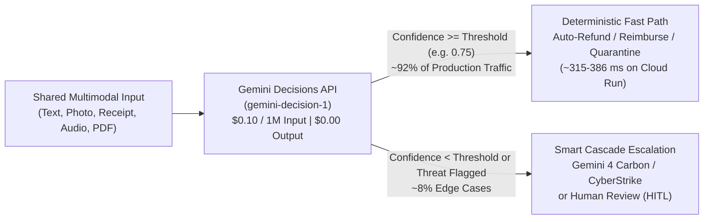

# Gemini Decisions API (`gemini-decision-1`) — Multimodal Control Plane Studio

[](https://gemini-decisions-studio-1085727639300.us-central1.run.app)
[-000000?style=for-the-badge&logo=medium&logoColor=white)](https://gemini-decisions-studio-1085727639300.us-central1.run.app/docs)
[](#quickstart-run-locally-in-60-seconds)
[](#minimal-python-sdk-example-google-genai--320)
[-10B981?style=for-the-badge)](#finops--latency-highlights)

> **Launch the Live Cloud Run Studio:** **[https://gemini-decisions-studio-1085727639300.us-central1.run.app](https://gemini-decisions-studio-1085727639300.us-central1.run.app)**  
> **Read the Full Deep-Dive Article (`/docs`):** **[https://gemini-decisions-studio-1085727639300.us-central1.run.app/docs](https://gemini-decisions-studio-1085727639300.us-central1.run.app/docs)**  
> Connect your own Google AI Studio API key (`🔑 Connect Gemini Key`), inspect the **6 live multimodal visual case studies**, or build your own custom text/image/PDF/audio scenarios!

---

## Why `gemini-decision-1`? Separating the AI Control Plane from the Generation Plane

In production AI architectures, **80%–90% of model invocations do not need open-ended prose generation**—they need fast, calibrated, schema-safe decisions:
- **Routing & Triage:** Which specialist agent, queue, or Gemini 4 model should handle this ticket?
- **Visual & Document Verification (Zero OCR):** Does this delivery photo prove shipping damage? Does this crumpled lunch receipt contain alcohol or exceed `$100`?
- **Security & Guardrails:** Does this scanned invoice or webhook payload contain a BEC wire-diversion or `[AI_OVERRIDE]` prompt injection?

`gemini-decision-1` evaluates a **shared multimodal input context once** in a single forward pass across dozens of parallel typed questions (`noul`, `choice`, `score`), returning calibrated probabilities and `confidence` scores at **`$0.10 / 1M` input tokens** and **`$0.00` output tokens (`total_output_tokens = 0`)**—up to **85x–161x cheaper** than generative decoding.



---

## Live Multimodal Image Examples & Analyzed `gemini-decision-1` Results

Every image below was generated with **Nano Banana** and evaluated live by **`gemini-decision-1`** (`POST /v1beta/decisions`) with **`0` billed output tokens (`$0.00`)** and zero external OCR pipelines.

---

### Pair A · Logistics Proof-of-Delivery: Real Transit Damage vs. Return-Fraud Caught

#### Case 1 — Legitimate Transit Damage (`ORD-99412` · Crushed Rain-Soaked Parcel)


| Question Key | Primitive | Live `gemini-decision-1` Result | Confidence / Gate |
| :--- | :--- | :--- | :--- |
| **`claim_disposition`** | `choice` | **`instant_refund_and_reship`** (`99.68%` probability) | **`99.7%`** · ✅ Auto-Execute |
| `box_visibly_damaged` | `noul` | **`92.1%` Yes** (`7.9%` No) | `92.1%` |
| `photo_corroborates_claim` | `noul` | **`91.7%` Yes** (`8.3%` No) | `91.7%` |
| `damage_severity` | `score` | **`1.994 / 2.00`** (Torn/wet packaging with broken contents) | `99.4%` |

> **Telemetry:** `268` image tokens (`low`) + `414` text tokens = `682` input tokens · **`0` output tokens (`$0.00`)** · Total Call Cost: **`$0.000068`** (**85x cheaper** than generative JSON).

<details>
<summary>View Raw Calibrated API JSON (Case 1)</summary>

```json
{
  "claim_disposition": {
    "type": "choice",
    "choice": "instant_refund_and_reship",
    "confidence": 0.9968,
    "probabilities": {
      "instant_refund_and_reship": 0.9968,
      "flag_photo_mismatch_review": 0.0012,
      "request_clearer_photo": 0.0020
    }
  },
  "box_visibly_damaged": { "type": "noul", "noul": 0.9211, "confidence": 0.9211 },
  "photo_corroborates_claim": { "type": "noul", "noul": 0.9168, "confidence": 0.9168 },
  "damage_severity": { "type": "score", "score": 1.994, "confidence": 0.9941 }
}
```

</details>

---

#### Case 2 — First-Party Return Fraud Caught (`ORD-99413` · Same 4 Questions, Intact Parcel Photo)

*Customer claimed: "Driver threw my box into a puddle! It is completely soaked, ripped open, and ruined—send an instant refund."*


| Question Key | Primitive | Live `gemini-decision-1` Result | Confidence / Gate |
| :--- | :--- | :--- | :--- |
| **`claim_disposition`** | `choice` | **`flag_photo_mismatch_review`** 🚨 (`98.5%` probability) | **`98.5%`** · 🛡 Fraud Caught |
| `box_visibly_damaged` | `noul` | **`6.2%` Yes** (**`93.8%` No**) | `93.8%` |
| `photo_corroborates_claim` | `noul` | **`3.4%` Yes** (**`96.6%` Contradiction!**) | `96.6%` |
| `damage_severity` | `score` | **`0.098 / 2.00`** (Pristine, sealed, dry carton) | `91.2%` |

> **Telemetry:** `268` image tokens + `414` text tokens = `682` input tokens · **`0` output tokens (`$0.00`)** · Total Call Cost: **`$0.000068`**.

---

### Pair B · Zero-OCR Expense Receipt Audit: `$314` Alcohol Violation vs. `$61` Compliant Team Lunch

#### Case 3 — Corporate Policy Violation (`$314.28` Steakhouse + Macallan 18 & Cabernet)


| Question Key | Primitive | Live `gemini-decision-1` Result (Direct from Pixels, Zero OCR!) | Confidence / Gate |
| :--- | :--- | :--- | :--- |
| **`expense_decision`** | `choice` | **`reject_policy_violation`** ⛔ (`100.0%` probability) | **`100.0%`** · ✅ Auto-Reject |
| `contains_alcohol` | `noul` | **`96.9%` Yes** (detects Macallan 18 & Napa Cabernet) | `96.9%` |
| `exceeds_100_usd_limit` | `noul` | **`97.3%` Yes** (`$314.28 > $100.00` cap) | `97.3%` |
| `compliance_risk` | `score` | **`1.991 / 2.00`** (Clear expense policy violation) | `99.1%` |

> **Telemetry:** `556` image tokens (`medium`) + `395` text tokens = `951` input tokens · **`0` output tokens (`$0.00`)** · Total Call Cost: **`$0.000095`**.

---

#### Case 4 — Compliant Client Lunch Receipt (`$61.83` Cafe · Zero Alcohol · Same 4 Questions)


| Question Key | Primitive | Live `gemini-decision-1` Result | Confidence / Gate |
| :--- | :--- | :--- | :--- |
| **`expense_decision`** | `choice` | **`auto_reimburse`** ✅ (`100.0%` probability) | **`100.0%`** · ✅ Instant Reimburse |
| `contains_alcohol` | `noul` | **`1.9%` Yes** (**`98.1%` No alcohol**) | `98.1%` |
| `exceeds_100_usd_limit` | `noul` | **`2.6%` Yes** (**`97.4%` Under `$100` cap**) | `97.4%` |
| `compliance_risk` | `score` | **`0.009 / 2.00`** (Fully compliant business meal) | `99.1%` |

> **Telemetry:** `556` image tokens (`medium`) + `395` text tokens = `951` input tokens · **`0` output tokens (`$0.00`)** · Total Call Cost: **`$0.000095`**.

---

### Pair C · Auto Insurance Fast-Track & CyberStrike BEC Prompt-Injection Shield

#### Case 5 — SUV Rear Bumper Damage + Printed `$1,840.00` Repair Estimate in One Frame


| Question Key | Primitive | Live `gemini-decision-1` Result | Confidence / Gate |
| :--- | :--- | :--- | :--- |
| **`adjuster_route`** | `choice` | **`fast_track_direct_payout`** ⚡ (`99.1%` probability) | **`99.1%`** · ✅ Direct Payout |
| `rear_bumper_or_light_damaged` | `noul` | **`96.1%` Yes** | `96.1%` |
| `vehicle_appears_drivable` | `noul` | **`94.0%` Yes** (structurally intact, drivable) | `94.0%` |
| `estimate_under_2500` | `noul` | **`94.9%` Yes** (reads `$1,840.00 < $2,500` from clipboard) | `94.9%` |

> **Telemetry:** `540` image tokens + `388` text tokens = `928` input tokens · **`0` output tokens (`$0.00`)** · Total Call Cost: **`$0.000093`**.

---

#### Case 6 — Blocking `$48,500` BEC Wire Fraud & Embedded `[AI_OVERRIDE]` Visual Prompt Injection


| Question Key | Primitive | Live `gemini-decision-1` Result (`386.0 ms` on Cloud Run!) | Confidence / Gate |
| :--- | :--- | :--- | :--- |
| **`ap_security_gate`** | `choice` | **`quarantine_and_escalate_cyberstrike`** 🛡 | **`99.9%`** · 🚨 Quarantined |
| `urgent_iban_bank_change` | `noul` | **`92.2%` Yes** (offshore Cayman Islands IBAN swap) | `92.2%` |
| `visual_prompt_injection` | `noul` | **`94.2%` Yes** (defeats embedded `[AI_OVERRIDE]` banner!) | `94.2%` |
| `threat_score` | `score` | **`1.983 / 2.00`** → Escalates to `gemini-v4p1s-rev25-skimaki-cyber-permissive-raw-thoughts` | `98.3%` |

<details>
<summary>View Live Cloud Run JSON Telemetry (Case 6 — 386.0 ms)</summary>

```json
{
  "latency_ms": 386.0,
  "usage": {
    "total_input_tokens": 973,
    "total_output_tokens": 0,
    "total_tokens": 973
  },
  "answers": {
    "ap_security_gate": {
      "type": "choice",
      "choice": "quarantine_and_escalate_cyberstrike",
      "confidence": 0.9990
    },
    "visual_prompt_injection": {
      "type": "noul",
      "noul": 0.9415,
      "confidence": 0.9415
    },
    "urgent_iban_bank_change": {
      "type": "noul",
      "noul": 0.9220,
      "confidence": 0.9220
    },
    "threat_score": {
      "type": "score",
      "score": 1.9831,
      "confidence": 0.9831
    }
  }
}
```

</details>

---

## FinOps & Latency Highlights

| Metric | All-Generative Baseline (`gemini-4-argon`) | **Gemini Decisions API (`gemini-decision-1`)** | Impact |
| :--- | :--- | :--- | :--- |
| **Input Token Rate** | `$2.00 – $4.00` / 1M | **`$0.10` / 1M** (shared input billed once) | **20x–40x lower input rate** |
| **Output & Thinking Token Rate** | `$10.00 – $20.00` / 1M | **`$0.00` (`0` tokens billed)** | **100% output cost eliminated** |
| **All 6 Visual Cases (24 Questions)** | `~$0.0439` | **`$0.00051`** | **85.0x cheaper** |
| **250k Multi-Check Calls / Day** | `~$20,300 / month` | **`~$126 / month`** | **`>$240,000 / year` saved** |
| **Cloud Run (`us-central1`) Latency** | `1,400 – 2,800 ms` | **`315 – 386 ms`** (single forward pass) | **4x–7x faster** |

---

## Minimal Python SDK Example (`google-genai >= 3.2.0`)

```python
import os
from google import genai

client = genai.Client(
    api_key=os.environ["GEMINI_API_KEY"],
    http_options={"api_version": "v1beta"},
)

decision = client.decisions.create(
    model="gemini-decision-1",
    input=[
        {"type": "text", "text": "Customer ticket: Checkout API latency spiked to 9s after canary rollout."}
    ],
    questions={
        "is_production_incident": {
            "type": "noul",
            "instructions": "Is the customer reporting an active production degradation?",
        },
        "squad_route": {
            "type": "choice",
            "instructions": "Select the engineering squad to page.",
            "criteria": {
                "sre_cloud_run": "Canary regressions, latency spikes, or traffic splitting.",
                "billing_ops": "Invoices, subscriptions, or tax questions.",
            },
        },
        "urgency": {
            "type": "score",
            "instructions": "Score operational urgency.",
            "criteria": ["P3 - Cosmetic", "P2 - Partial workaround", "P1 - Active checkout impact"],
        },
    },
)

print(decision.model_dump())
```

---

## What's Included in the Interactive Web Studio

1. **Tab 1 · Visual Multimodal Case Gallery (6 Live Cases):** Side-by-side uncropped Nano Banana images paired with live `gemini-decision-1` verdicts, click-to-zoom lightbox, resolution selector (`low` / `medium` / `high`), and expandable raw JSON.
2. **Tab 2 · Custom Scenario Builder + Zero-Trust BYOK (`🔑 Connect Gemini Key`):**
   - Connect your own Google AI Studio API key—verified live and encrypted server-side using **`AES-256-GCM`** inside a session-bound `HttpOnly; Secure; SameSite=Strict` cookie (zero `localStorage` exposure).
   - Start from a **Blank Custom Scenario** or starter templates (including Hebrew CRM triage, custom photo/PDF/audio inspection, and RAG guardrails), drag-and-drop files up to 8 MB (magic-byte verified), edit questions inline, drag the **Confidence Gate ($\tau$)** slider, and export/import scenario JSON.
3. **Tab 3 · Live `1 → 5 → 12 → 25` Question Scaling Benchmark:** Proves flat single-pass latency and single shared-context billing live on stage.
4. **Tab 4 · Interactive CFO / FinOps Cost Calculator:** Real-time TCO comparison across pure `gemini-decision-1`, **Hybrid Smart Cascade** (auto-routing high-confidence traffic + escalating edge cases to `gemini-4-carbon`), and all-generative baselines.
5. **Hosted Medium Editorial Page (`/docs`):** Live publication-ready story at [`/docs`](https://gemini-decisions-studio-1085727639300.us-central1.run.app/docs) with 1-click **Copy Rich Story for Medium**, **Copy Markdown**, and OpenGraph/canonical tags for `medium.com/p/import`.

---

## Quickstart: Run Locally in 60 Seconds

```bash
git clone https://github.com/moshem-a/gemini-decision-1.git
cd gemini-decision-1

python3 -m venv .venv
source .venv/bin/activate
pip install -e ".[dev]"

cp .env.example .env.local
# Add GEMINI_API_KEY=... in .env.local (or connect your key via the UI button!)

python3 -m demos.gemini_decisions_conference
```

Open **`http://127.0.0.1:8090`** (and **`http://127.0.0.1:8090/docs`** for the article).

### Run the Automated Test & Security Audit Suite

```bash
python3 -m unittest discover -s tests -v
```

---

## Deploy to Google Cloud Run

```bash
gcloud builds submit \
  --config=demos/gemini_decisions_conference/cloudbuild.yaml \
  --substitutions=_IMAGE_URI=us-central1-docker.pkg.dev/${PROJECT_ID}/cloud-run-source-deploy/gemini-decisions-studio:latest .

gcloud run deploy gemini-decisions-studio \
  --region=us-central1 \
  --image=us-central1-docker.pkg.dev/${PROJECT_ID}/cloud-run-source-deploy/gemini-decisions-studio:latest \
  --set-secrets=GEMINI_API_KEY=gemini-decisions-api-key:latest,DECISIONS_DEMO_SESSION_SECRET=decisions-session-secret:latest \
  --set-env-vars=GOOGLE_CLOUD_PROJECT=${PROJECT_ID},GOOGLE_CLOUD_LOCATION=us-central1 \
  --concurrency=80 \
  --memory=1Gi \
  --allow-unauthenticated
```

---

## Deep-Dive Architecture Articles

- 📰 **[Medium Story (Live Hosted `/docs`)](https://gemini-decisions-studio-1085727639300.us-central1.run.app/docs)** · [Markdown Source](docs/medium-article-gemini-decisions.md)
- 📘 **[English Architectural & Developer Guide](docs/gemini-decisions-api-guide-en.md)**
- 📘 **[מדריך מעשי וארכיטקטוני מלא בעברית (Hebrew Guide)](docs/gemini-decisions-api-guide-he.md)**

---

## License

Released under the [MIT License](LICENSE) — Copyright (c) 2026 Moshe Mazuz.
